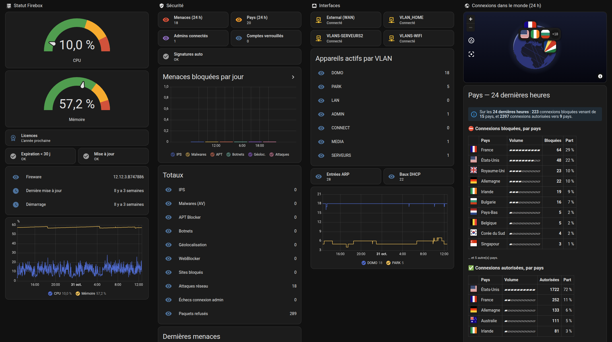

# hass-watchguard-firebox


[](https://github.com/hacs/integration)

Intégration Home Assistant pour les **WatchGuard Firebox** (Fireware 12.x), inspirée de [hass-pfsense](https://github.com/travisghansen/hass-pfsense).

pfSense expose une API XML-RPC locale ; Fireware n'a pas d'équivalent pour un Firebox géré localement. L'intégration utilise donc :

- la **CLI Fireware en SSH (port 4118)**, en lecture seule (`show …`), pour l'état du Firebox ;
- en option, le **syslog du Firebox** (UDP), pour les menaces bloquées et la carte des pays.

Rien n'est à installer sur le Firebox. Testée sur un Firebox T25, Fireware 12.12.3.



*Le tableau de bord fourni dans [`dashboards/`](dashboards/), sur un Firebox T25.*

## Entités (v0.3)

Toutes les entités sont rattachées à **un seul appareil**, le Firebox. La page d'un appareil Home Assistant n'a que des blocs fixes (Capteurs, Diagnostic…) : le regroupement par thème se fait dans la vue [`dashboards/firebox.yaml`](dashboards/firebox.yaml) (blocs Statut, Sécurité, Interfaces, Carte).

### Statut

| Entité | Source |
|---|---|
| CPU 1 min (5 et 15 min désactivés par défaut) | `show sysinfo` |
| Mémoire utilisée (%, + libre / utilisée désactivées) | `show sysinfo` |
| Dernier démarrage, version Fireware | `show sysinfo` |
| Expiration des abonnements (la plus proche) + *Abonnements bientôt expirés* (< 30 j) | `show features` |
| Dernière mise à jour Fireware + *Échec de la dernière mise à jour* | `show upgrade` |

### Sécurité

| Entité | Source |
|---|---|
| Abonnement IPS, Gateway AntiVirus, APT Blocker, WebBlocker, DNSWatch, TDR, RED, spamBlocker, Application Control, LiveSecurity… (date d'expiration + jours restants) | `show features` |
| MAJ auto des signatures désactivée (problème) | `show signature-update` |
| Sessions d'administration (hors HA), comptes verrouillés | `show login-user`, `show locked-out` |
| **Compteurs** : détections IPS, malwares bloqués (AV), menaces APT, botnets, géolocalisation, WebBlocker, sites bloqués, attaques réseau (flood, scan, spoofing), échecs de connexion admin, paquets refusés… | syslog |
| **Menaces bloquées (24 h)** (détail par catégorie et 10 dernières menaces en attributs) | syslog |
| **Dernière menace** (type, IP, pays, signature/virus, policy) | syslog |
| **Pays bloqués (24 h)** (top 15 avec drapeau en attribut) | syslog |
| Réception syslog, dernier message syslog (diagnostic) | syslog |

Les compteurs sont des `total_increasing` : ils se tracent jour par jour avec la carte *Graphique des statistiques*, et ils survivent aux redémarrages de HA.

### Interfaces

| Entité | Source |
|---|---|
| État de chaque interface (les interfaces désactivées sont créées désactivées) | `show interface` |
| Appareils actifs par VLAN (zone, adresse, baux DHCP en attributs) | `show arp` + `show vlan` |
| Entrées ARP, baux DHCP | `show arp`, `show dhcp lease` |

### Autres

- **Suivi de présence** (`device_tracker`) des appareils choisis dans les options, à partir de la table ARP.
- **Carte des pays** : une entité `geo_location.firebox_<iso3>` par pays vu dans les dernières 24 h (bloquées ⛔ / autorisées ✓).
- **Événement** `watchguard_firebox_threat` à chaque menace bloquée (au plus 30 par minute), pour les automatisations.

## Prérequis côté Firebox

1. **Compte dédié** : *System > Users and Roles*, créer un utilisateur `ha_monitor` (base Firebox-DB) avec le rôle **Device Monitor**. N'utilise pas `admin`.
2. **Accès restreint** : la policy *WatchGuard* (port 4118) doit autoriser l'IP de Home Assistant vers *Firebox*, et rien de plus large depuis le VLAN domotique.
3. **Syslog** (optionnel, pour la partie sécurité) : voir ci-dessous.

## Installation

1. HACS > menu ⋮ > *Dépôts personnalisés* > `https://github.com/Tuxinit/hass-watchguard-firebox`, catégorie **Intégration**.
2. Installer **WatchGuard Firebox**, puis redémarrer Home Assistant.
3. *Paramètres > Appareils et services > Ajouter une intégration > WatchGuard Firebox*.
4. Renseigner l'IP du Firebox, le port `4118` et le compte `ha_monitor`.

## Activer le syslog (menaces et carte)

**Côté Home Assistant** : *WatchGuard Firebox > Configurer* :

- cocher **Recevoir le syslog du Firebox** ;
- port UDP (défaut `5514`) ;
- **IP source autorisée** : l'IP avec laquelle le Firebox émet vers HA, c'est-à-dire son adresse sur le VLAN de HA (ex. `172.25.5.1`). Tout datagramme venant d'une autre IP est ignoré : le syslog UDP n'est pas authentifié.

**Côté Firebox** (Fireware Web UI) : *System > Logging > Syslog Server* :

- activer *Send log messages to the syslog server at this IP address* ;
- IP de Home Assistant, port `5514`, format **Syslog** (pas IBM LEEF ni CEF) ;
- cocher *The time stamp* et *The serial number of the device*.

Pour que les compteurs se remplissent, les services doivent journaliser : c'est le cas par défaut pour IPS, Gateway AV, APT Blocker, Botnet Detection et les paquets refusés non gérés. Pour voir aussi les **connexions autorisées** sur la carte, active *Send a log message* dans l'onglet *Logging* des policies concernées. Attention au volume si tu le fais sur des policies très sollicitées.

La géolocalisation vient des champs `geo_src` / `geo_dst` que Fireware ajoute aux logs de trafic. Il faut que le service **Geolocation** soit actif ; aucune base GeoIP n'est nécessaire côté HA.

Le menu *Diagnostics* de l'intégration montre les compteurs bruts, les IP rejetées et des exemples de lignes non reconnues, utiles pour affiner la classification.

## Tableau de bord


[`dashboards/firebox.yaml`](dashboards/firebox.yaml) contient une vue en cartes natives (aucun module front à installer), avec un bloc par thème :

- **Statut Firebox** : jauges CPU/mémoire, licences, mises à jour, historique ;
- **Sécurité** : menaces 24 h, admins connectés, comptes verrouillés, menaces bloquées par jour, totaux, dernières menaces, abonnements ;
- **Interfaces** : état des interfaces, appareils actifs par VLAN, ARP/DHCP ;
- **Carte** : connexions dans le monde (24 h), tableau des pays, dernière menace.

Pour l'installer : *Tableau de bord > ⋮ > Modifier > ⋮ > Éditeur de configuration brute*, puis coller la vue sous `views:`. [`dashboards/firebox-dashboard.yaml`](dashboards/firebox-dashboard.yaml) est la version complète, à coller telle quelle dans un tableau de bord neuf.

Si le Firebox est rangé dans une pièce, les versions récentes de Home Assistant préfixent les nouvelles entités par le nom de la pièce (ex. `sensor.garage_jurassic_t25_…`) : adapte les identifiants, ou liste-les avec le modèle `{{ integration_entities('watchguard_firebox') }}` (*Outils de développement > Modèle*).

Carte du monde seule :

```yaml
type: map
geo_location_sources:
  - watchguard_firebox
default_zoom: 1
```

## Exemples d'automatisations

Notification à chaque malware ou menace APT :

```yaml
automation:
  - alias: Firebox — malware bloqué
    triggers:
      - trigger: event
        event_type: watchguard_firebox_threat
        event_data:
          category: antivirus
      - trigger: event
        event_type: watchguard_firebox_threat
        event_data:
          category: apt
    actions:
      - action: notify.mobile_app_mon_telephone
        data:
          title: "Firebox : {{ trigger.event.data.category }}"
          message: >-
            {{ trigger.event.data.detail }} — {{ trigger.event.data.src_ip }}
            → {{ trigger.event.data.dst_ip }}
```

Session d'administration inattendue :

```yaml
automation:
  - alias: Firebox — session d'administration
    triggers:
      - trigger: numeric_state
        entity_id: sensor.jurassic_t25_sessions_d_administration
        above: 0
    actions:
      - action: notify.mobile_app_mon_telephone
        data:
          title: Firebox
          message: >-
            Session d'administration ouverte :
            {{ state_attr(trigger.entity_id, 'sessions')
               | map(attribute='user') | join(', ') }}
            depuis {{ state_attr(trigger.entity_id, 'sessions')
               | map(attribute='ip') | join(', ') }}
```

## Options

| Option | Défaut | Rôle |
|---|---|---|
| Intervalle de scrutation | 30 s | fréquence des `show` rapides (licences, historique, VLAN : toutes les heures) |
| Lire les baux DHCP | oui | désactive `show dhcp lease` si le Firebox ne fait pas le DHCP |
| Considérer présent pendant | 180 s | fenêtre glissante après la dernière vue ARP |
| Recevoir le syslog | non | compteurs de menaces, carte des pays, événements |
| Port UDP syslog | 5514 | |
| IP source(s) syslog autorisée(s) | IP du Firebox | séparées par des virgules |
| Appareils à suivre | aucun | liste construite à partir des baux DHCP et de la table ARP |

## Sécurité

- **Clé d'hôte SSH (TOFU)** : l'empreinte SHA-256 de la clé du Firebox est mémorisée à l'ajout de l'intégration. Si elle change (reset usine, RMA… ou interception), la connexion est refusée et HA demande une ré-authentification, avec une case à cocher pour accepter explicitement la nouvelle clé.
- **Session persistante** : une seule session CLI est ouverte et réutilisée, pour éviter une connexion (et une ligne de log de management) toutes les 30 s.
- **Syslog** : filtrage par IP source, simple analyse de texte, événements limités à 30 par minute.
- **Diagnostics** : identifiants, numéro de série et MAC sont masqués dans l'export de diagnostic.

## Limites connues

- **Débit par interface / par IP** : la CLI ne l'expose pas. Il faudra SNMPv3 (par interface) ou NetFlow (par IP), prévus dans une version ultérieure.
- **Version Fireware disponible** : `show upgrade` ne donne que l'historique ; pas d'entité `update` pour l'instant.
- **Classification syslog** : les msg_id viennent du Fireware Log Catalog. Botnet, Tor et géolocalisation passent par des messages génériques et sont reconnus par mots-clés : envoie des lignes réelles (menu Diagnostics) si un compteur reste à zéro alors que le Firebox bloque.

## Feuille de route

- [x] Licences, mises à jour, signatures, sessions d'administration, comptes verrouillés (v0.2)
- [x] Compteurs de menaces, carte des pays, vue en blocs par thème (v0.3)
- [ ] Débit par interface (SNMPv3) et par IP (NetFlow)
- [ ] Stockage système (`show sys-storage`), tunnels VPN (`show vpn-status`)
- [ ] Actions optionnelles (compte admin) : redémarrage, activer/désactiver une policy, bloquer une IP

## Développement

```bash
pip install -r requirements_test.txt
pytest
```

Les tests rejouent des sorties CLI réelles (anonymisées), testent le client SSH contre un faux serveur CLI Fireware et envoient de vrais datagrammes syslog au récepteur.

## Licence

MIT. Coordonnées des pays : [mledoze/countries](https://github.com/mledoze/countries) (ODbL). Drapeaux : [flag-icons](https://github.com/lipis/flag-icons) (MIT).
